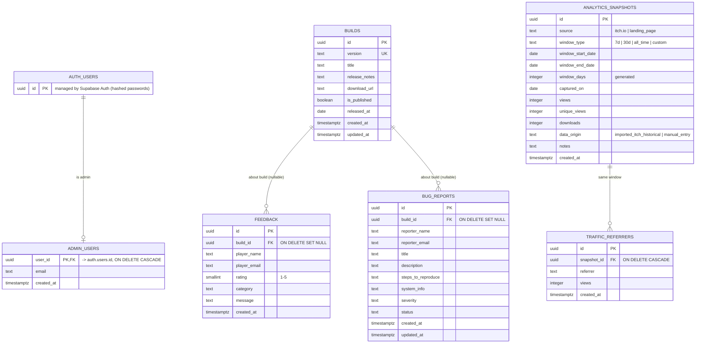

# ERD – Off Flame Together (matches `20261023000001_init_schema.sql`)

**Design note:** `traffic_referrers` is a child of `analytics_snapshots`, so every referrer
figure inherits an explicit date window. Public visitors cannot write to it.
